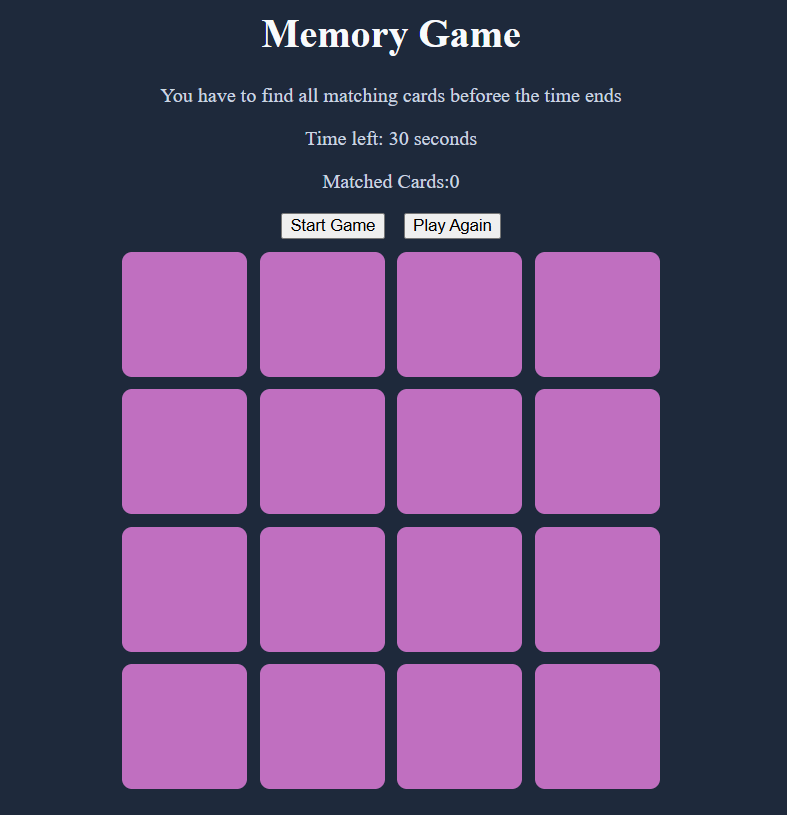

[Play the game](https://samialreashy.github.io/memory-game-/)

### Game description

Memory Game is a card matching game where players flip cards to find matching pairs before the time runs out. The cards are shuffled into random positions every time a new round begins, so no two games look the same. The player has 30 seconds to find all the matching pairs.

## How to Play

- Click **Start Game** to begin. The cards are shuffled and the 30 second timer starts.
- Click a card to flip it and see the picture.
- Click a second card to try to find its match.
- If the two cards match, they stay face up.
- If they do not match, they flip back after 1 second.
- The **Matched Cards** counter goes up every time you find a pair.
- Find all the matching pairs before the time ends to win.
- Click **Play Again** to reset the timer and the score and shuffle the cards.

## Features

- Cards shuffle randomly every time the game starts or restarts
- 30 second countdown timer
- Matched pairs stay open
- Cards cannot be clicked before the game starts
- Cards are locked for a moment while two wrong cards are showing, so the player cannot flip a third card
- The same card cannot be clicked twice to make a match

## Techs Used

- HTML
- CSS
- JavaScript

## Getting Started

Goal: Build the basic game layout and functionality, allowing the player to start the game, flip cards, match pairs, and see the timer and matched cards counter updated.

Start: PUT-START-DATE-HERE
End: PUT-END-DATE-HERE

## Credits

- Shuffle: cards are picked at random from a list one by one using `splice`, then placed back on the board in that order